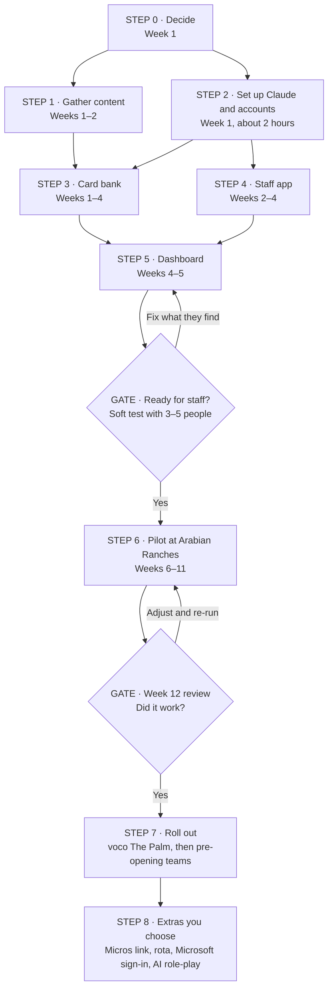

# Maison Academy: your roadmap, David

This is your map from idea to a live pilot at Arabian Ranches, and then to every venue. Claude does the building. You make the decisions, gather the content and run it on the floor.

Two files work together:

- **`MAISON_ACADEMY_BUILD_BRIEF.md`** tells Claude what to build and how to work with you. Give it to Claude; you don't need to read every line.
- **This roadmap** tells you what to do, in what order, and what to say to Claude at each step.

**Time:** about 12 weeks to the review, if decisions and content arrive on time. Most of the waiting is content, not code.

---

## Who's who

| Person | Role |
| --- | --- |
| **You (David)** | Build lead and product owner. You decide, test, approve service and SOP cards, and run the pilot. |
| **Gerard** | Concept and foundational design. Owner on every account. Receives a short report at the end of each phase. |
| **Head of Culinary or head chef** | Approves food and allergen cards. |
| **Bar lead** | Approves drinks cards. |
| **Pilot champion** | A supervisor at Arabian Ranches who keeps it alive day to day. |
| **HR or counsel** | Reads the privacy notice before staff use the app. |
| **Claude** | Builds, drafts cards, writes the reports and keeps the records. |

**A shared project.** Maison Academy is Creneau's, and it started with Gerard: the idea, the research and the framework are his. You lead the build. He stays a partner as it grows, so the two of you can steer it together and nothing depends on one person. In practice: the accounts are company accounts with you both as owners, the code carries a company copyright notice, and Gerard, as an owner, is kept in the loop on the build — GitHub keeps him posted and Claude writes a short progress note and a backup of the card bank at the end of each phase. None of it reports on you or any staff member, and it never includes names, scores or passwords. It's continuity, not a check-up.

---

## The map

| Step | What happens | Who | When | Report to Gerard |
| --- | --- | --- | --- | --- |
| 0. Decide | Answer the four must-have decisions | You | Week 1 | |
| 1. Gather content | Collect the files Claude writes cards from | You, chef, bar lead, finance | Weeks 1–2 | |
| 2. Set up | Claude, a project folder, three company accounts | You, guided by Claude | Week 1 | Phase 0 |
| 3. Card bank | Claude drafts Level 1 cards; reviewers approve | Claude, chef, you | Weeks 1–4 | Phase 1 |
| 4. Staff app | The phone app staff use each shift | Claude, you test | Weeks 2–4 | Phase 2 |
| 5. Dashboard | Your view of every venue and person | Claude, you test | Weeks 4–5 | Phase 3 |
| Gate | Soft test with 3–5 staff for a week | You, pilot champion | Week 5 | Phase 4 |
| 6. Pilot | Six weeks at Arabian Ranches | You, venue team | Weeks 6–11 | Monthly backup |
| Gate | Review against the agreed measures | You, Gerard | Week 12 | Phase 5 |
| 7. Roll out | Other venues and pre-opening teams | You, Claude | Week 12 on | Each rollout |
| 8. Extras | Only what the pilot shows is worth it | You decide | Later | Each extra |

---

## Step 0: Decide (week 1)

These four come first. Write your answers down; Claude will ask for them.

- [ ] **Our sequence of service.** The exact steps and timings to teach, from welcome to farewell.
- [ ] **Who approves cards.** Suggested: Head of Culinary or head chef for food and allergens, bar lead for drinks, you for service and SOPs.
- [ ] **When staff practise.** On paid time: pre-shift, a break, or a shared tablet at the pass.
- [ ] **Pilot.** Arabian Ranches for six weeks, and one supervisor on site who champions it.

Six more can wait until week 3: level targets, what Level 3 earns (pin, title, pay or rota), weekly target per contract, whether staff see their own sales trend, which menu items count as add-ons, and the app's final name.

---

## Step 1: Gather content (weeks 1–2)

Claude writes cards only from what you give it. Missing files mean missing cards, never guessed ones.

| File | Who has it | Needed for |
| --- | --- | --- |
| Sequence of service, written out | You | Service track, Level 1 |
| Current menus for each venue (PDF) | Gerard / marketing | Food track |
| Allergen matrix (export from Meez) | Head of Culinary | Every allergen card |
| Dish photos (phone photos are fine) | Marketing or venue chef | Photo cards |
| Drinks list: beers with styles and serves, coffee, wines, cocktails, alcohol-free | Bar lead | Drinks track |
| Add-on list: items that count as upsell or suggestive (dessert, coffee, sides, premium drinks) with Micros item numbers | Gerard / finance | Selling measure |
| SOPs: allergen procedure, payments, alcohol service, guest recovery, opening and closing | You | SOP track |
| Pilot venue roster: Micros employee number, first name, last initial, role, start month | You / HR | Activating staff |
| One Micros employee sales export, plus the 8 weeks before launch | Finance / IT | Selling baseline |

Put everything in one folder called `content` inside your project folder.

---

## Step 2: Set up Claude and the accounts (week 1, about 2 hours)

**Claude.** Use **Claude Code** or the **Claude desktop app with a folder on your computer**, so Claude can create files, run the app and publish it. An ordinary chat can draft and check cards, but it can't build and host the app.

1. Create a folder on your computer called `maison-academy`.
2. Put `MAISON_ACADEMY_BUILD_BRIEF.md` in it. If you use Claude Code, rename it to `CLAUDE.md` so it loads by itself.
3. Put your `content` folder inside it.
4. Open the folder in Claude and paste the kick-off prompt below.

**Accounts.** Claude walks you through each one, click by click.

- Create them with a **shared Creneau mailbox**, not your personal email, so access survives staff changes.
- As soon as each account exists, **add Gerard (gerard.mccormick@creneau.com) and yourself as owners**, so you both have a hand on it.
- Gerard, as an owner, watches the GitHub project, so he's kept up to date on the build as it goes (Claude will tell you exactly what to send him to switch this on).

| Account | What it's for | Cost |
| --- | --- | --- |
| GitHub | Keeps every version of the code, the phase reports and the card backups | Free |
| Supabase | The database, logins and the app's back office. Region: Frankfurt. | Free while building; USD 25 a month (about AED 92) before real staff use it |
| Netlify | Puts the app on the web. A separate team or account from Dock & Trace. | Free while building; USD 9 to 20 a month (about AED 33 to 73) before the pilot |

**Kick-off prompt:**

> Read the build brief. We're starting Phase 0. Ask me the open decisions one at a time, check what's in my content folder and tell me what's missing, then guide me through setting up the accounts, including the ownership and reporting set-up in section 13. Keep `PROGRESS.md`, `DECISIONS.md` and `HANDOVER.md` up to date.

**Done when:** a Maison Academy page is live, Gerard has confirmed his access, and the first report is published.

---

## Step 3: Card bank (weeks 1–4)

Claude builds a content studio (a simple admin screen for cards) and drafts Level 1 cards from your files: service steps, every core dish's allergens and tags, the core menu and SOP basics. Target: **100 to 150 live cards** before the pilot.

**Your part:** reviewers approve cards in the studio, and the chef checks every allergen card against the matrix. Allow about two hours per reviewer per 50 cards.

**Prompt:**

> Read the build brief and PROGRESS.md. Start Phase 1. Build the content studio, then draft Level 1 cards from the files in my content folder. Mark anything the files don't confirm as [TO CONFIRM] and list those for me.

---

## Step 4: Staff app (weeks 2–4)

The phone app: activation code, PIN, today's set of five cards, "how sure were you?", the right answer and why it matters, review my misses, levels and the weekly rhythm.

**One change from the deck, on purpose.** Version 1 counts the streak in weeks (for example 4 sets a week) instead of shifts, because the app has no rota data yet. Days off still never break it. Per-shift streaks come later with a rota import.

**Your part:** test it on your own phone, plus one iPhone and one Android. Use the test mode to jump the date forward and check that missed cards come back.

**Prompt:**

> Read the build brief and PROGRESS.md. Start Phase 2: the staff app. Show me each screen working before moving on, and give me three test logins.

---

## Step 5: Dashboard (weeks 4–5)

Your view, matching the prototype Gerard made: Overview, Venue, Person and Questions, plus practical sign-offs and new-menu sets.

**Your part:** check you can answer three questions from it each Monday: is the team practising, what do they know, and what should we coach this week.

**Prompt:**

> Read the build brief and PROGRESS.md. Start Phase 3: the dashboard. Use the prototype as the look, and fill it with test data so I can try every view.

---

## Gate: ready for staff? (week 5)

**Prompt:**

> Start Phase 4. Import the Arabian Ranches roster from my content folder, make a printable activation sheet, add the daily reminder, and run the testing checklist from the brief. Tell me what's left before a soft launch.

Then:

1. Have HR or counsel read the privacy notice.
2. Soft-launch with 3 to 5 staff for one week. Ask them what confused them.
3. Send Claude what they found, with screenshots. Fix, then go.

---

## Step 6: Pilot at Arabian Ranches (weeks 6–11)

**Launch day:** at pre-shift, hand out activation codes, help everyone add the app to their home screen (on iPhone: Share, then Add to Home Screen), and do the first set together. It takes about ten minutes.

**Your Monday routine (about 30 minutes):**

1. Open the dashboard Overview. Note practice, floor-ready share and mastery.
2. Take the three "coach this week" topics to the pre-shift huddles, with the suggested question.
3. Recognise people from the list, out loud, at pre-shift.
4. Check private allergen prompts with the venue manager, and walk through the matrix with that person, kindly.
5. Open Questions and send Claude the most-missed cards to reword:

> Read PROGRESS.md. These cards are most missed this week: [list]. Suggest clearer wording or explanations, keeping the facts the same. Put changes in review for me.

6. Upload the weekly Micros export once the importer is ready.
7. If the menu changes, send Claude the new menu the same day for a "new on the menu" set.

**First Monday of each month:** "Export the card bank and settings to the backup folder and commit them."

**Remember:** in-app scores often look lower than floor performance while people are learning. That's expected. Judge the pilot on the floor and in Micros.

---

## Gate: week 12 review

Agree these measures **before** the pilot starts, then check them here:

- Most rostered staff meeting their weekly target each week.
- Every FOH team member at Level 1 (floor ready).
- Mastery still held after 7 days or more.
- Fewer "sure but wrong" allergen answers over the six weeks.
- Add-on rate per 100 guests up against each server's own baseline, and against voco The Palm, which carries on as normal during the pilot.
- One question to staff and supervisors: "Did this help you on shift?"

**Prompt:**

> Read PROGRESS.md. Prepare the week-12 review: each agreed measure, the numbers, and what you'd change before rollout. Then write the phase report and publish the release.

Go through it with Gerard before deciding on rollout.

---

## Step 7: Roll out (week 12 on)

voco The Palm first, then the pre-opening teams for Dubai South, Pullman JLT and Al Mouj as soon as they're hired. Pre-opening is where the app saves the most time. Al Mouj is in Oman, where staff must give explicit consent in the privacy notice; the brief covers this.

Then Level 2 and 3 cards: the full menu, drinks and selling badges.

---

## Step 8: Extras, only if the pilot earns them

| Extra | Why you might want it |
| --- | --- |
| Micros link (automatic) | No more weekly upload |
| Rota import | Streaks and reminders by shift |
| Microsoft 365 sign-in for managers | One login; needs Creneau IT |
| Weekly digest by email | A Monday summary without opening the dashboard |
| AI guest role-play | Practise a wine suggestion or an allergen question out loud |
| Second language | If staff ask for it |

---

## Working well with Claude

- **Start every session:** "Read the build brief and PROGRESS.md, then tell me where we are."
- **End every session:** "Update PROGRESS.md, DECISIONS.md and HANDOVER.md, and tell me what's next."
- **End every phase:** "Write the phase report, export the card bank, and publish the release."
- **One phase per session.** Long, mixed sessions get muddled.
- **Reporting a problem:** a screenshot, what you did, what you expected, what happened.
- **If you're lost:** "Explain where we are in plain English, and what you need from me."
- **If Claude suggests something not in the brief,** it should ask first. You can say no.
- **Never paste passwords or keys into the chat.** Claude will tell you where they go.

---

## Costs, year one (about 100 staff)

| Item | Cost |
| --- | --- |
| Supabase Pro | USD 300 a year (about AED 1,100) |
| Netlify paid plan | USD 108 to 240 a year (about AED 400 to 880) |
| GitHub | Free |
| Optional extras (SMS codes, WhatsApp reminders, Power BI) | Up to about USD 1,100 a year more |
| **Running total** | **About AED 1,900 to 7,300 a year** |
| Your Claude plan | Under Creneau's existing plan |

Prices were checked on 15 October 2026 at 1 USD = 3.6725 AED. The bigger cost is time: writing and reviewing content.

---

## Reference

- Concept brief, research and sources: https://claude.ai/code/artifact/545fffe1-dd89-433d-a945-ec56b9e879b1
- Dashboard and staff app prototype (sample data): https://claude.ai/artifact/MkvusFEkhhtDrqmUo5U8AL
- Deck with your notes: `Maison_Academy_for_David.pptx`

If a link doesn't open, ask Gerard to share it with you.
